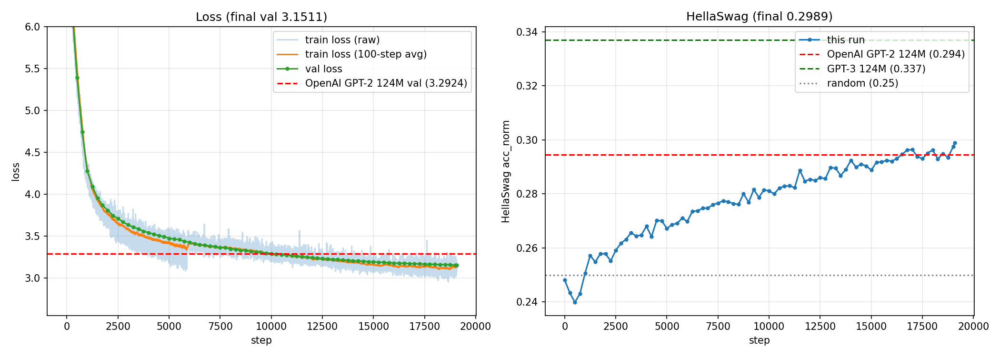
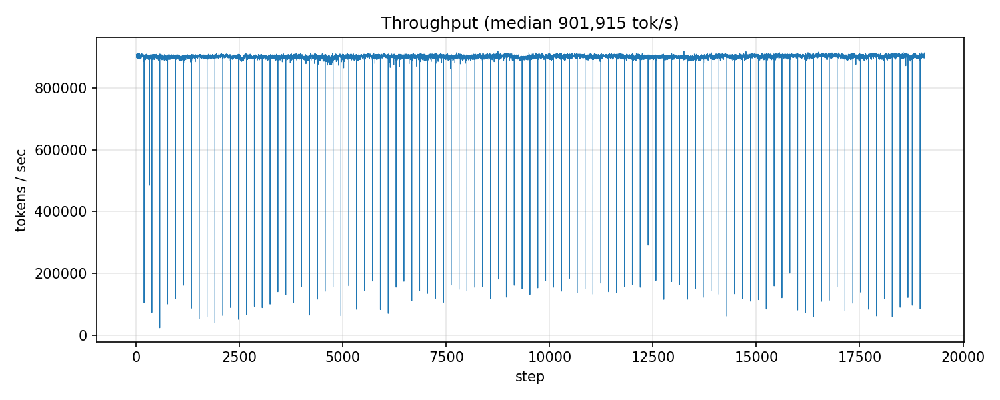

# Reproducing GPT-2 124M from scratch: 2× H100, 3.9 hours, ~$39

**Result:** my GPT-2 124M, trained from scratch on 10B tokens of FineWeb-Edu, beats OpenAI's GPT-2 124M on both metrics I tracked.

| | Mine | OpenAI GPT-2 124M |
|---|---|---|
| Val loss (FineWeb-Edu val shard) | **3.1511** | 3.2924 |
| HellaSwag acc_norm (10,042 val examples) | **0.2989** | 0.2945 |
| Training tokens | ~10B (1 epoch) | ~100B (reported) |
| Hardware / wall clock | 2× H100 SXM, 3 h 55 min | — |
| Cost | ~$39 total (data + perf study + run) | — |

The val-loss gap favours my model by construction: it is measured on FineWeb-Edu, which is my training distribution and not GPT-2's. HellaSwag is the fair comparison (neither model trained on it), and there the gap is small but positive.

Code follows Karpathy's [build-nanogpt](https://github.com/karpathy/build-nanogpt), typed by hand. Everything below was measured by me unless marked as a reference number.

---

## 1. Setup

| | |
|---|---|
| Model | GPT-2 124M: 12 layers, 12 heads, d=768, T=1024, vocab padded 50257 → 50304. 124.5M params (tied embeddings) |
| Data | FineWeb-Edu `sample-10BT`, tokenized with GPT-2 BPE into 100 shards × 100M `uint16` tokens. Shard 0 = val. **9,953,989,344 tokens total** |
| Batch | 524,288 tokens/step (2¹⁹) = B 64 × T 1024 × 2 GPUs × 4 grad-accum micro-steps |
| Schedule | 19,073 steps (~1 epoch), linear warmup 715 steps to 6e-4, cosine decay to 6e-5 |
| Optimizer | Fused AdamW, β=(0.9, 0.95), eps 1e-8, weight decay 0.1 on 2-D params only, grad clip 1.0 |
| Precision / kernels | TF32 matmuls, bf16 autocast, `torch.compile`, SDPA flash attention |
| Parallelism | DDP over 2× H100 SXM 80 GB, NVLink (NV18) |
| Evals | Every 250 steps: val loss (20 batches), HellaSwag (full 10,042), 4 text samples per GPU. Checkpoints at 5k, 10k, 15k, 19,072 |

**Data prep:** 16-vCPU CPU pod, `datasets` in streaming mode (no 73 GB HF cache), 8 tokenizer workers. ~9M tokens/s, **21 minutes, $0.17**.

---

## 2. Throughput study: FP32 → 11× faster

One H100 SXM, B=16 (rows 1–6), 20 steps per row, average of steps 3–19. **Each row changes exactly one thing from the row above.** MFU uses the peak for the precision in use (bf16 dense: 989 TFLOPS).

Training FLOPs per token are counted exactly, not with the 6N rule:

$$\text{FLOPs/token} = 3 \times \big(2 P_{\text{matmul}} + L \cdot 4 T d\big), \quad P_{\text{matmul}} = 12 L d^2 + dV$$

That gives 854,654,976 at V=50304. The attention term is ~15% of the total at T=1024, which 6N ignores.

| # | Config | ms/step | tok/s | TFLOPS | MFU | Mem | Gain | Cumulative |
|---|---|---|---|---|---|---|---|---|
| 1 | FP32, manual attention, vocab 50257 | 12,401.9 | 42,275 | 36.1 | 54% of FP32 peak | 34.7 GB | — | 1.0× |
| 2 | + TF32 | 5,844.3 | 89,709 | 76.7 | 15% of TF32 peak | 34.7 GB | 2.12× | 2.1× |
| 3 | + bf16 autocast | 5,164.4 | 101,519 | 86.7 | 8.8% | 32.3 GB | 1.13× | 2.4× |
| 4 | + `torch.compile` | 1,790.7 | 292,782 | 250.2 | 25.3% | 24.2 GB | **2.88×** | 6.9× |
| 5 | + flash attention (SDPA) | 1,284.5 | 408,158 | 348.8 | 35.3% | 14.5 GB | 1.39× | 9.7× |
| 6 | + vocab 50304 | 1,207.4 | 434,255 | 371.1 | 37.5% | 12.9 GB | 1.06× | 10.3× |
| 7 | B = 64 | 1,123.7 | 466,566 | 398.8 | **40.3%** | 44.3 GB | 1.07× | **11.0×** |
| 8 | DDP, 2 GPUs | 574.3 | 912,982 | 780.3 | 39.4% | 44.8 GB | **1.96×** (98% scaling) | 21.6× |

Reference: my Mac Studio M2 Ultra (MPS, FP32 + compile) did ~10–11k tok/s. Row 1, H100 in plain FP32, is already ~4× faster: ~2.5× from raw FP32 throughput, ~2× from more mature kernels (54% vs ~26% of peak).

**Why each step moved the number:**

- **TF32 (2.1×):** routes FP32 matmuls to the tensor cores. Loss unchanged (val 7.6294 vs 7.6293).
- **bf16 (only 1.13×):** the surprise. Manual attention builds a B×n_h×T×T = 16×12×1024×1024 ≈ 201M-element score matrix per layer, then reads and writes it several times (scale, mask, softmax). Those steps are memory-bound, and autocast keeps softmax in FP32. Faster matmuls can't help when the time goes to memory traffic. Memory barely moved (34.7 → 32.3 GB), which confirms the big tensors were still there.
- **compile (2.9×):** fuses those memory-bound chains (attention softmax, layernorm, GELU) into far fewer kernels, so each tensor is read and written once instead of many times. It also saved 8 GB of intermediates.
- **flash attention (1.4×):** computes attention in tiles that stay in on-chip SRAM, so the T×T matrix is never written to HBM. That saved another 10 GB.
- **vocab 50304 (1.06×):** 50304 = 128 × 393, so `lm_head` (the largest matmul) tiles evenly. More parameters, but faster.
- **B=64 (1.07×):** 8 micro-steps per optimizer step instead of 32, so less fixed per-step overhead.
- **DDP (1.96×):** one gradient all-reduce per optimizer step, about 0.87 GB per GPU (2(N−1)/N × 124M × 4 B), takes ~2 ms over NVLink and overlaps with backward.

**The order matters.** bf16 looked nearly useless until compile and flash removed the memory-bound attention bottleneck. Each row's gain depends on what came before it, so this table describes one path, not independent effects.

---

## 3. Predicted vs actual

Total training compute:

$$C = 854{,}654{,}976 \times 19{,}073 \times 524{,}288 \approx 8.55 \times 10^{18}\ \text{FLOPs}$$

| | Predicted | Actual |
|---|---|---|
| Training time, from the measured 912,982 tok/s (row 8) | 19,073 × 524,288 / 912,982 = **3.04 h** | **3.20 h** pure step time (+5%) |
| …of which shard-load stalls (finding 2) | not modelled | 0.12 h → **3.08 h without them, within 1.3%** |
| Evals (78 × ~48 s; estimated from the first 11 min) | ~1.0 h | 0.71 h |
| Wall clock | ~4.1 h (from the first 11 minutes) | **3.91 h** |
| Cost of the run (2× H100 at $7.99/h) | ~$33 | **~$31** |

Run MFU, using the median 901,915 tok/s (450,958 per GPU):

$$\text{MFU} = \frac{854{,}654{,}976 \times 450{,}958}{989 \times 10^{12}} \approx 39.0\%$$

Mean throughput was lower (897,424 tok/s; 604.8 ms vs 581.3 ms median), because of the stalls below.

**What MFU means.** Model FLOPs Utilization is the share of the GPU's peak compute spent on the model's required math. Only the FLOPs the model needs count (the formula above), not extra work like recomputation. Shortcut from `perf.csv`: MFU ≈ (TFLOPS column ÷ number of GPUs) ÷ 989.

**bf16 MFU progression** (same 989 TFLOPS peak throughout):

| Config | bf16 MFU |
|---|---|
| bf16, manual attention, no compile (row 3) | 8.8% |
| + compile (row 4) | 25.3% |
| + flash attention (row 5) | 35.3% |
| + vocab 50304 (row 6) | 37.5% |
| B = 64 (row 7) | 40.3% |
| Full run, 2 GPUs, median | **39.0%** |

**Is 39% good?** It is solid for a 124M model on an H100. Published large-scale runs report PaLM 540B at 46.2% and Llama 3 405B at about 38–43% on H100s, and those models have far larger matmuls that keep tensor cores busy. At d = 768, fixed per-step costs take a bigger share. Where the remaining ~60% goes: shard-load stalls (3.8%, finding 1), many small memory-bound kernels (fusion or CUDA graphs would help, as llm.c does), the optimizer step and gradient clipping, and matmuls that are small for this GPU. A wider model would reach a higher MFU on the same hardware: d = 1024 gave +19% TFLOPS on the Mac.

---

## 4. Findings

**1. Shard loading stalls the GPUs every 190 steps: 7.4 minutes lost (3.8% of training).**
The throughput plot shows exactly 100 dips, spaced 190 steps apart. That matches 100M tokens per shard ÷ 524,288 tokens per step = 190.7. At each shard boundary, `load_tokens()` reads 200 MB from the network volume and converts it to a 100M-element int64 tensor (800 MB), synchronously, on both ranks. The GPUs sit idle meanwhile.
*Fix:* prefetch the next shard in a background thread, or `np.load(mmap_mode="r")` and convert only each batch to int64.

**2. Train loss shows a step discontinuity around step 5,900; val does not.**
Raw train loss runs unusually low over roughly steps 4,800–5,900, then jumps back. Val loss is smooth through it. That means the cause is data order, not optimization: shards are read in file order with no shuffling, so a run of easier documents shows up as a "better" stretch.
*Fix:* shuffle shard order per epoch and permute documents within each shard.

**3. HellaSwag is still climbing at the end.**
It passes GPT-2 at step 16,500 (~8.7B tokens) and finishes at its best value (0.2989). Val loss first goes below GPT-2's at step 10,000 (~5.2B tokens). A second epoch would most likely keep improving both.
Note: at ~80 tokens per parameter, this run is already 4× past the Chinchilla compute-optimal ~20.

**4. Evals under `torch.compile` work if you evaluate the uncompiled module.**
build-nanogpt skips HellaSwag and sampling when compile is on, because the compiled model breaks on the variable-shaped eval inputs. Running those evals on `raw_model` (same weights, never compiled or DDP-wrapped) keeps compiled training at full speed while evaluating every 250 steps. Evals cost ~48 s each, 18% of wall-clock time.

**5. Apple MPS gives a silently wrong loss above 2³¹ logits elements.**
At B=64 on the Mac, step-0 loss was 7.14 instead of ~10.95. B × T × V = 64 × 1024 × 50304 ≈ 3.3×10⁹ > 2³¹, so an index overflow is the likely cause. B=32 (1.65×10⁹) is correct. Predicted safe limit: B ≤ 41.

---

## 5. Samples (step 19,072, top-k 50)

Prompt: *"Photosynthesis is the process"*

> Photosynthesis is the process by which plants turn food into energy in the form of sugars. Most plants require light in order to synthesize glucose (sugars). …

On topic and textbook-styled (FineWeb-Edu shows through), but factually unreliable: other samples placed photosynthesis "in the body" or "the deep sea". At 124M parameters and 10B tokens the model has learned word associations (photosynthesis ↔ light ↔ glucose), not facts.

Prompt: *"The meaning of life is"*. Mine reads like a self-help or explainer blog. OpenAI's GPT-2 (same prompt and seed) writes numbered philosophical paragraphs in older prose, which reflects WebText. Both are locally fluent and globally incoherent after a paragraph or two.

---

## 6. Cost and infrastructure notes

| Item | Cost |
|---|---|
| Data prep (16-vCPU CPU pod, 21 min) | $0.17 |
| Perf study (2× H100, ~40 min) | ~$5.3 |
| Full run (2× H100, ~4.2 h incl. setup + smoke test) | ~$33.5 |
| Download (CPU pod) | <$0.10 |
| **Total** | **~$39** (+ $7/month network volume while it exists) |

**Lesson:** putting the data on a region-locked network volume made GPU capacity in that one region the constraint. The run waited days for 2× H100 in US-MO-1, while other regions had capacity. Data that is cheap to regenerate (21 min, $0.17) shouldn't decide where you train.

---

## Files

- `train_gpt2.py`: model, data loader, training loop, DDP, evals, perf logging
- `fineweb.py`: dataset download and tokenization (streaming)
- `hellaswag.py`: HellaSwag loader and scorer
- `perf_results/`: per-row CSVs and console log for the throughput study
- `log_full_run/`: `log.txt`, `perf.csv`, `train.log`, checkpoints (checkpoints not in git)
- `plot.ipynb`, `plot_log.py`: plots and analysis
- `sample.py`: text generation and comparison with OpenAI GPT-2
